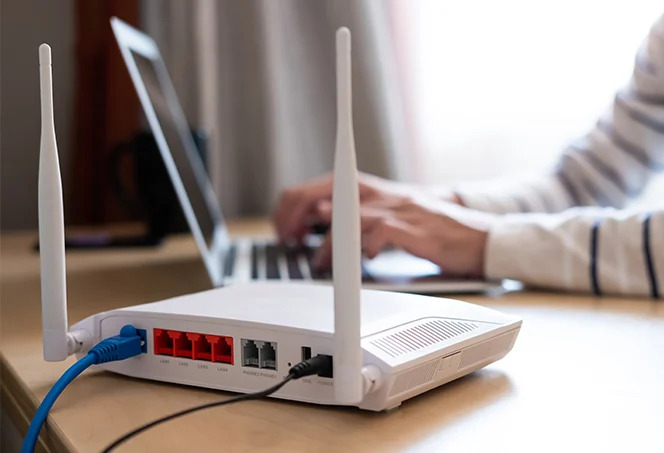
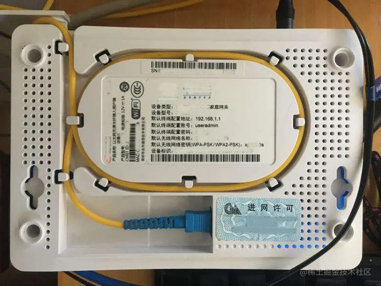

# 网络基础

::: tip 选择性必修
这一章不需要提交课后任务，也不要求一次记完所有概念。我们会先建立一张网络地图，再学会用几条 Linux 命令观察自己的网络环境。
:::

## 为什么算法组也要懂一点网络

算法组的工作看起来主要是在写程序，而当只要程序需要离开开发环境，就绕不开网络。

比如：

- 用 SSH 登录车上的小电脑，串流软件看程序运行画面
- 让一台电脑上的摄像头节点和另一台电脑上的算法节点通过 ROS 2 通信(不用网线还是算了)
- 在宿主机和虚拟机之间传文件，实验室内传输文件
- 部署程序到设备
- 安装各种各样的神秘小软件完善开发环境(哦对的对的)

这些操作的界面各不相同，底层却都会遇到同一类问题：两台设备能不能找到彼此，数据应该往哪里走，以及一个名字怎样变成可以访问的地址。

网络知识比较多，网上也能找到大量很深的课程。对我们来说，暂时不需要研究协议的具体实现，先能看懂开发环境中常见的网络配置就够了。这一章也不会介绍 TCP 握手的细节，讨论 IP 地址和转发时会用“IP”来代指这部分内容。

## 先看一张网络地图

一个比较典型的网络连接可以画成这样：

```text
电脑、虚拟机、小电脑
        │
        ├── 有线网线 ── 交换机 ── 路由器 ── 光猫 ── ISP ── Internet
        │
        └── Wi-Fi ─────── 无线路由器 ────┘
```

这不是唯一的结构，也不是每一层都会单独出现。比如实验室电脑可能直接接在交换机上，家用路由器可能同时承担交换机、无线接入点和路由器的功能，有些网络里也不一定能直接看到“光猫”这个设备。

先记住一件事：

> 网络不是一个抽象的黑盒，数据需要经过真实接口和设备一段一段地传下去。 *具体要先了解网络结构分层分工*

## 常见网络硬件

### 网卡

网卡（network interface）负责让计算机接入网络。`ip a` 中看到的 `lo`、`enp3s0`、`wlan0` 等名称，都是系统中网络接口的名字。

- `lo`：本机回环接口，用于让计算机访问自己
- `enp...`、`eth...`：常见的有线网卡
- `wlan...`：常见的无线网卡

虚拟机会使用虚拟网卡，因此虚拟机里也能看到自己的网络接口。
::: tip 提示
Win的网卡展示 : Win + R ，输入 ncpa.cpl   
混乱的网卡管理可能出现网络问题，所以不要乱安装代理工具，除非你知道你做了什么
:::

### 网线

网线提供最基础的物理传输通道。线插好以后，接口通常会出现链路状态，但“线连上了”和“已经能够通过 IP 通信”不是一回事。

后面会看到：即使网线没问题，没有地址、地址不在同一网段或防火墙拦截，设备仍然可能互相访问不了。

### 交换机

交换机（switch）用来连接同一个局域网中的多台设备。

```text
电脑 A ─┐
电脑 B ─┼─ 交换机
电脑 C ─┘
```

它让局域网里可以接更多设备。家用路由器背后通常已经内置了一个小交换机，所以不一定需要再单独买一台。

### 路由器

路由器（router）负责在不同网络之间转发数据。

当目的地址不在当前局域网里时，计算机会把数据交给默认网关，而路由器就是这个路径上的关键设备。它通常还会参与 DHCP、NAT 和防火墙等工作。

日常说的“家用路由器”往往同时集成了很多功能，不等于“只有路由功能的一台设备”。


### 光猫

光猫通常用于光纤宽带，把运营商的光信号转换成计算机和路由器能够使用的网络信号。

有些光猫只做信号转换，有些光猫还集成了路由和拨号功能。实验室或宿舍的网络结构可能不同，不必看到一台设备就立刻认定它的全部职责。


### ISP

ISP（Internet Service Provider）是互联网服务提供商，也就是为家庭、学校或实验室提供互联网接入服务的运营商。

路由器连接到运营商以后，数据还需要经过 ISP 的网络继续转发，才有机会到达远端服务器。

## Wi-Fi 的某些概念

Wi-Fi 经常和“网络”一起出现，但它主要改变的是最后一段数据怎样传输：

```text
有线：计算机 ── 网线 ── 交换机/路由器
Wi-Fi：计算机 ── 无线电 ── 无线路由器
```

::: warning 可以作为兴趣了解一下
Wi-Fi 的频段、信道、天线和 802.11 协议。

Wi-Fi 把网线换成了无线电，IP 地址、网卡、网关、DHCP、NAT 和 DNS 等概念仍然存在。
:::

因此，后面学习的大部分内容不只适用于有线网络，也适用于 Wi-Fi。只不过在做虚拟机桥接、远程桌面和多机通信时，有线连接通常更容易观察和排查。

## 家用路由器为什么这么“好用”

很多家用路由器实际上把几种功能包在了一起：

- 交换机：提供多个有线网口
- 无线接入点：给手机和电脑提供 Wi-Fi
- 路由器：在不同网络之间转发数据
- DHCP 服务器：自动分配 IP、网关和 DNS
- NAT：让内网设备共用公网连接

这也是为什么把一个新设备接进家里的网络后，它往往不需要手工填写地址就能访问互联网。

但“即插即用”并不代表网络没有配置，只是配置由其他设备自动完成。后面学习 DHCP、网关和 NAT 时，我们会把这条链路重新拆开。

## 直接连接两台电脑可以通信吗

先思考一个简单场景：

> 如果只用一根网线把两台电脑直接连起来，中间没有路由器，它们能通信吗？

答案是：要看双方的网络配置。

网线可以提供物理通道，现代网卡一般也能自动适配常见线序。但仅仅有通道还不够，双方仍然需要：

- 网卡处于启用状态
- 双方拥有可以互相理解的 IP 地址
- 地址处于同一网段，或者存在一个可用的网关
- 系统防火墙允许相应的通信

第二页会把这个问题拆成两步：先用 `ip a` 观察网卡和地址，再用静态 IPv4 地址完成一次直连实验。

::: tip 动手看看：画出自己的网络路径
先不修改任何配置，只观察你现在使用的电脑。
:::

### 第一步：写出你正在使用的设备

例如：

```text
台式机
虚拟机
实验室小电脑
路由器
交换机
```

不需要把没有接触过的设备硬写进去。

### 第二步：判断设备之间怎样连接

可以用下面的模板：

```text
设备 A ── 网线/Wi-Fi ── 设备 B
```

例如：

```text
虚拟机 ── 虚拟网卡 ── 宿主机
宿主机 ── 网线 ── 实验室交换机
交换机 ── 路由器 ── Internet
```

### 第三步：标出未知部分

不知道某个设备连接到了哪里时，直接标记为“未知”，不需要猜。

```text
我的电脑 ── Wi-Fi ── 未知路由器 ── Internet
```

这张图不需要一次画完。学完 `ip a`、`ip route` 和 `ping` 以后，可以回来修正它。

## 接下来观察什么

网络排错通常遵循“从近到远”的顺序：

```text
网卡是否启用
  → 本机有没有 IP
  → 目标是否在同一网段
  → 默认网关是否存在
  → DNS 是否正常
  → 目标服务是否启动
```

下一页 : Linux 命令查看本机的网络接口和 IPv4 地址。
