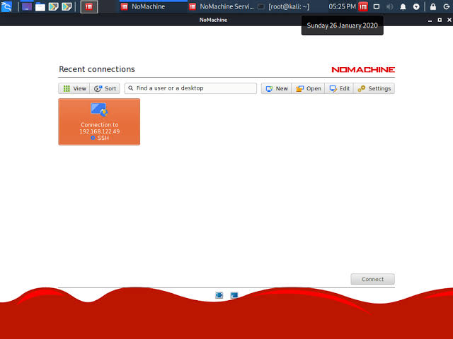

# 桥接与远控

前面的知识已经可以解释：

- 本机有哪些网络接口和地址
- 两台设备什么时候可以在同一网段直接通信
- DHCP 怎样自动提供配置
- 数据怎样经过网关、NAT、DNS 和 ISP 到达公网

这一页把同样的知识放回两个实际场景：

1. 让虚拟机像局域网中的另一台设备一样被访问
2. 用 NoMachine 从一台电脑远程控制另一台电脑

## 虚拟机常见的三种网络模式

以 VirtualBox 为例，虚拟机网络适配器常见有 NAT、桥接和 Host-only 等模式。不同虚拟机软件的叫法略有区别，但核心思路相近。

| 模式 | 虚拟机大致处在什么位置 | 外部设备能否直接访问 | 常见用途 |
|:-:|:-|:-:|:-|
| NAT | 藏在宿主机后面的虚拟网络中 | 通常需要端口转发 | 上网方便，隔离性较好 |
| 桥接 | 像宿主机所在局域网中的另一台设备 | 同一局域网内通常可以 | SSH、ROS 2 多机通信、远程桌面 |
| Host-only | 只连接宿主机和同类虚拟网络 | 局域网其他电脑通常不能 | 隔离实验 |

### 虚拟机 NAT

NAT 模式可以理解为虚拟机先访问宿主机，再由宿主机侧的网络功能访问外部世界。

```text
虚拟机 → 虚拟 NAT → 宿主机 → 物理网络
```

虚拟机上通常能正常访问互联网，但在其他电脑看来，它不一定是一台可以直接找到的局域网设备。

### 虚拟机桥接

桥接模式会把虚拟网卡接到宿主机实际所在的局域网中：

```text
虚拟机 ─┐
        ├─ 实验室/家庭局域网
宿主机 ─┘
```

在配置正确时，虚拟机会像局域网中的另一台电脑：

```text
宿主机：192.168.1.20/24
虚拟机：192.168.1.30/24
网关：  192.168.1.1
```

它可以拥有自己的 IPv4 地址，也可以与同一局域网中的其他设备直接通信。

但桥接不等于自动配置成功。虚拟机仍然需要：

- 选择正确的物理网卡
- 从 DHCP 获得地址，或者手动配置正确地址
- 与目标处在同一网段，或者有正确网关
- 允许相应的 ping、远程桌面端口通过

### Host-only

Host-only 模式通常只让虚拟机和宿主机之间组成一个隔离的小网络，外部的其他电脑不会直接进入。

适合需要隔离但又要与宿主机通信的实验。

## 动手看看一：将虚拟机切换为桥接

### 第一步：关闭虚拟机

先正常关闭虚拟机。多数虚拟机软件在虚拟机运行期间不能完整修改网络适配器。

### 第二步：修改网络模式

在虚拟机软件的设置中找到“网络”或“网络适配器”，选择：

```text
桥接网卡
Bridged Adapter
```

如果界面要求选择桥接到哪一块物理网卡，应选择宿主机当前实际连接局域网的有线网卡。

### 第三步：启动虚拟机并查看地址

分别打开宿主机和虚拟机的终端：

```bash
ip a
```

寻找名称中带有 `enp...`、`eth...` 或相似字样的接口，并记录 IPv4 地址和前缀。

例如：

```text
宿主机：192.168.1.20/24
虚拟机：192.168.1.31/24
```

如果两边前三段相同，并且前缀都是 `/24`，它们通常处在同一个局域网。

### 第四步：查看虚拟机默认网关

在虚拟机中执行：

```bash
ip route
```

应该能找到类似：

```text
default via 192.168.1.1 dev enp3s0
```

如果只有本网段路由，没有默认路由，虚拟机可能能够和局域网设备通信，却不能访问其他网段或互联网。

### 第五步：宿主机 ping 虚拟机

假设虚拟机 IP 是 `192.168.1.31`：

```bash
ping -c 4 192.168.1.31
```

### 第六步：虚拟机 ping 宿主机

假设宿主机 IP 是 `192.168.1.20`：

```bash
ping -c 4 192.168.1.20
```

两个方向都能收到回复时，说明基本 IP 通路已经建立。

### 如果无法互相 ping

按顺序检查：

1. 虚拟机是否真的处于桥接模式
2. 是否桥接到了宿主机实际使用的网卡
3. 双方是否获得了同一网段的 IPv4 地址
4. 虚拟机是否有默认网关
5. 宿主机或虚拟机的防火墙是否阻止 ICMP
6. 校园网或实验室网络是否启用了客户端隔离

::: warning 桥接不是万能开关
部分虚拟机软件对 Wi-Fi 桥接支持不稳定。如果桥接无线网卡时无法获得地址，可以改用有线网卡，或者先用 Host-only 验证虚拟机内部配置。
:::

宿主机是 Windows 时，Windows 防火墙或当前网络配置文件也可能影响虚拟机访问宿主机。不要为了验证直接关闭全部防火墙，应先确认当前网络是否被识别为可信网络，并检查 ICMP 规则。

## SSH 和 NoMachine

SSH 主要通过命令行登录另一台设备：

```text
控制端终端 → SSH 服务 → 被控端终端
```

NoMachine 提供图形桌面远程控制：

```text
控制端 NoMachine 窗口 → 被控端桌面
```

两者都依赖同一组基础条件：

- 被控设备有可达的 IP 地址
- 控制端能够连接到被控设备
- 被控设备上的相应服务已经启动
- 防火墙允许服务使用的网络连接

区别主要在交互方式和使用的服务，不在于“远程控制不需要网络”。

## 安装 NoMachine 并远控

下面的步骤假设两台电脑处在同一局域网，并且已经能够互相 ping。

### 下载并安装

从 [NoMachine 官方网站](https://www.nomachine.com/download)下载适合操作系统的安装包。

控制端和被控端都需要安装 NoMachine。被控端就是最后要展示远程桌面的那台电脑。

::: warning
注意nomachine的用户协议！截止文档撰写，最后个人版本是收费的(去互联网找找 v9 版本)
:::
Ubuntu 下载到 `.deb` 包后，可以在下载目录执行：

```bash
sudo apt install ./nomachine_*.deb
```

### 找到被控端 IP

在被控端执行：

```bash
ip a
```

记录它与当前局域网通信所用接口上的 IPv4 地址，例如：

```text
192.168.1.50
```

在控制端执行：

```bash
ping -c 4 192.168.1.50 # 验证通路
```

不要使用 `127.0.0.1` 作为另一台电脑的连接地址。`127.0.0.1` 永远只表示设备自己。

### 尝试远程桌面

打开 nomachine 
连接成功后，控制端应该能够看到被控端的图形桌面(NX 的局域网发现)。

可以打开一个终端再次执行：

```bash
hostname
ip a
```

确认自己看到的是被控端的系统信息，而不是控制端本机。





